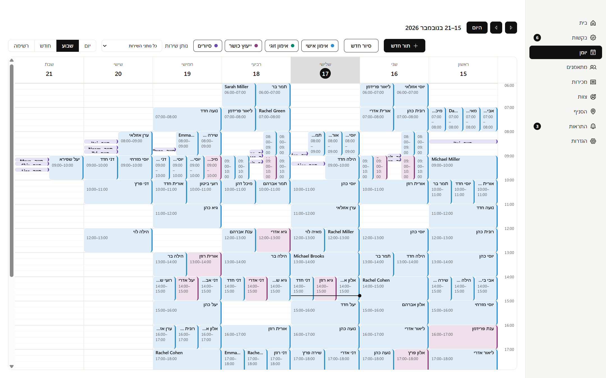
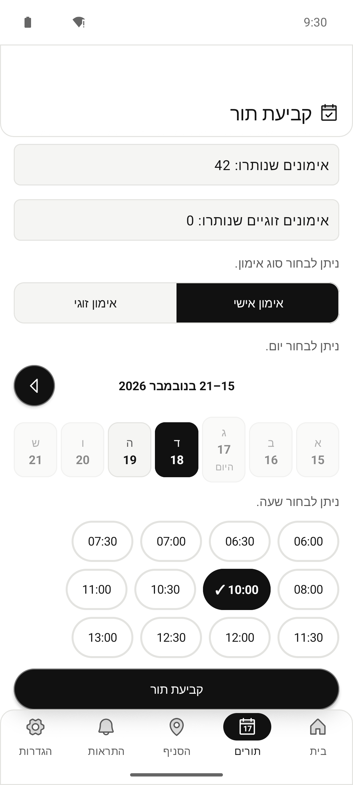
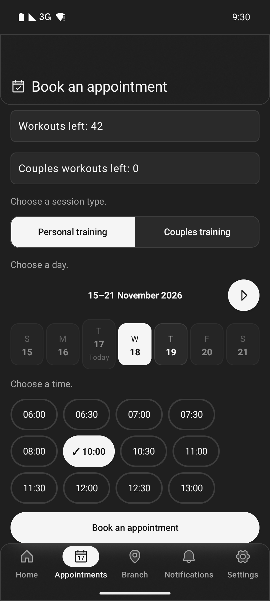
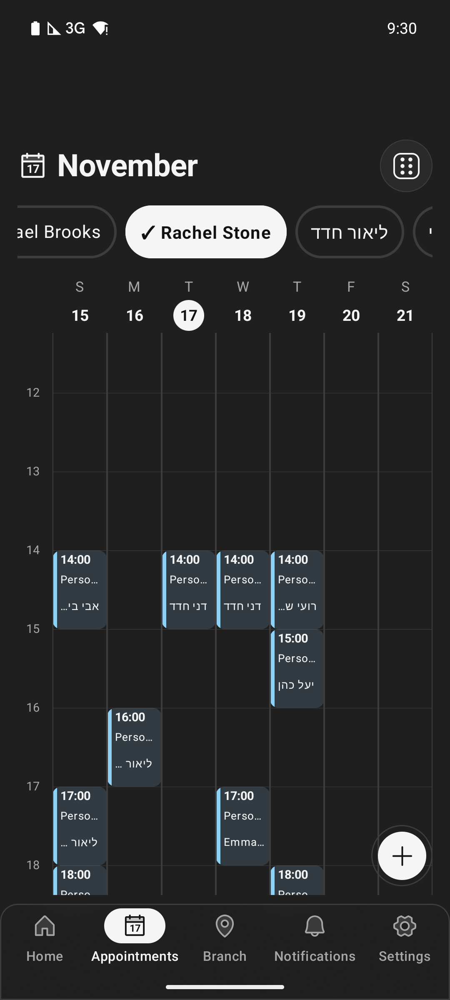
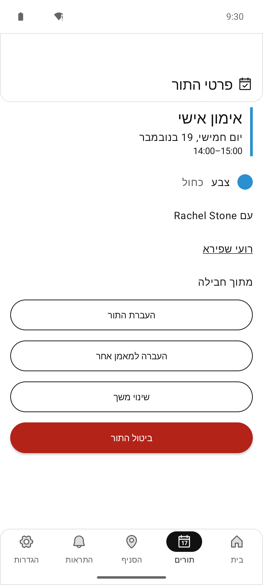
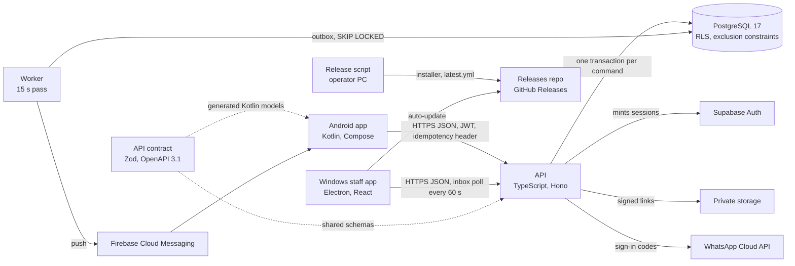
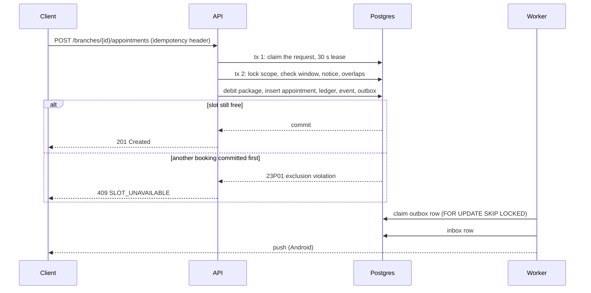

# GymBro

GymBro is an appointment booking system for gyms, built Hebrew-first and right to left: members book sessions with their trainer on Android, and staff run calendars, packages and the branch from Android or a Windows desktop app.

This repository documents the system. The source is private.



| Member books a session | The same screen in English | A trainer's week on Android | Appointment details |
|---|---|---|---|
|  |  |  |  |

All screenshots show synthetic data from a local seed.

## What it does

- A member sees the workouts left in their package and books an open time of their own trainer. The server enforces the trainer's notice window and refuses overlaps. Couples sessions take one credit from each partner.
- Trainers publish their availability a week at a time; each week goes live on the Friday at 12:00 before it starts.
- Staff work in day, week, month and list calendars. Trainers book, move and hand off their trainees' sessions, reception books consultant meetings and guest tours, and managers handle packages, memberships and opening hours.
- Members get an inbox entry and an Android push for changes, and reminders 24 and 2 hours before a session, held overnight from 22:00 to 07:00.
- Sign-in is a phone number and a WhatsApp code, with no email or password. Phones stay signed in until 90 days without use; the Windows app takes a code once per PC, then a four-digit PIN.
- Every screen works in Hebrew and English, light and dark, and Hebrew text follows each person's chosen form of address.

## System overview

Both clients call one TypeScript API, a modular monolith on Vercel. Each request's work runs in one Postgres transaction under a restricted role, with the caller's account, acting role and branch set as transaction-local settings that row-level security reads. Because the API is serverless, a separate worker makes a pass every 15 seconds: it publishes availability weeks, turns outbox rows and due reminders into inbox entries, and sends push. There is no websocket channel; clients refetch after a write, and the Windows app polls its inbox every 60 seconds. The Windows app updates itself from a separate repository that holds installers and no code.



Components, data model and deployment: [docs/architecture.md](docs/architecture.md).

## How a booking works

1. The client fetches candidate slots: the trainer's published windows, clipped to opening hours.
2. It sends the booking with an idempotency header. The API claims it in a short transaction with a 30-second lease, so a retry replays the stored answer.
3. In a second transaction, as the signed-in actor, the API locks the member, share-locks the provider's settings and the overlapping availability weeks in ascending id order, and checks the window, the notice rule and the member's other bookings.
4. It locks the member's packages, debits the valid package that expires first, and inserts the appointment, a ledger row, an event and an outbox row, all in one commit.
5. The worker picks up the outbox row on its next pass.



Two requests that arrive together can both pass the checks in step 3. What stops the double booking is a Postgres exclusion constraint: for one provider, no two confirmed appointments may have overlapping time ranges, in any branch. Its shape, as an illustration with generic names:

```sql
-- Illustration with generic names, not the project's code
create extension if not exists btree_gist;
alter table bookings add constraint bookings_no_overlap
  exclude using gist (provider_id with =, during with &&)
  where (status = 'confirmed');
```

The second insert waits on the first one's uncommitted row, then fails with SQLSTATE `23P01`, which the API returns as `409 SLOT_UNAVAILABLE`; a deadlock is retried and ends the same way. A second exclusion constraint keeps a staff member's tours and appointments apart, and a check constraint stops the last credit being spent twice.

Two tests prove it on every CI run against real Postgres. At the database level, two connections insert overlapping appointments for the same trainer; the test waits in `pg_stat_activity` until the second is blocked on a lock, commits the first, and asserts that the second failed with `23P01` and the trainer has one appointment. At the API level, two members send parallel HTTP requests for one slot: one gets `201`, the other `SLOT_UNAVAILABLE`, and the loser leaves nothing behind. Sibling tests race the last credit and a move against a cancel.

## Design decisions

- [The database is the last guard against an invalid booking.](docs/decisions.md#the-database-is-the-last-guard-against-an-invalid-booking) Over application checks alone, which race: Postgres constraints and triggers refuse overlaps, overspent packages and out-of-hours bookings even if a TypeScript rule has a bug. The cost is rules in two languages.
- [One contract, generated clients.](docs/decisions.md#one-contract-and-generated-clients) Over hand-written models per client: Zod schemas validate requests, type the desktop client and produce OpenAPI 3.1, which generates the Kotlin models. The generators are code to maintain.
- [Permissions are checked in the API and again in Postgres.](docs/decisions.md#permissions-are-checked-in-the-api-and-again-in-postgres) Over API checks alone: nine roles and 38 permission grants, enforced by middleware and by row-level security that reads the request's single acting role. The cost is a policy set on every table and a separate test suite for it.
- [Background work goes through an outbox and an always-on worker.](docs/decisions.md#background-work-goes-through-an-outbox-and-an-always-on-worker) Over sending from the request: a failed push never undoes a booking. While the worker is down nothing is sent; when it returns, overdue weeks publish and reminders already too late are dropped.
- [Built for Israel: Hebrew first and one time zone.](docs/decisions.md#built-for-israel-hebrew-first-and-one-time-zone) Over generic multi-region support: gendered Hebrew strings, Unicode isolates around numbers, and every branch pinned to `Asia/Jerusalem` by a check constraint. A second country means lifting that pin.
- [The desktop app updates from a code-free public repository.](docs/decisions.md#the-desktop-app-updates-from-a-code-free-public-repository) Over the private repo as the feed: the API forces old versions to update with HTTP 426. Builds run on one PC and are unsigned for staging, so Windows warns once per install.

## Built with

| Layer | Technology |
|---|---|
| Android app | Kotlin 2.4, Jetpack Compose, Material 3, OkHttp, kotlinx.serialization, Firebase Cloud Messaging; minSdk 26 |
| Windows staff app | Electron 45, electron-vite, React 19, TanStack Query, electron-builder (NSIS), electron-updater |
| API and worker | TypeScript, Hono 4, Zod 4, Drizzle ORM with hand-written SQL, postgres.js, jose, Temporal polyfill |
| Shared packages | Booking domain, API contract, typed client, calendar layout core, Hebrew and English strings; pnpm workspaces |
| Database | PostgreSQL 17 on Supabase with row-level security, `btree_gist` exclusion constraints and PL/pgSQL; Supabase Auth and Storage |
| Messaging | WhatsApp Cloud API for sign-in codes, FCM HTTP v1 for push |
| Hosting (staging) | Vercel (Frankfurt) and Supabase; the worker as a systemd service |
| Tests and CI | Vitest, Playwright, JUnit, Robolectric, Compose UI tests, GitHub Actions |

## Testing

Case counts are test declarations found by grep (`it(` and `test(` in TypeScript, `@Test` in Kotlin), not runner output.

| Level | Covers | Files | Cases | In CI |
|---|---|---:|---:|---|
| Booking domain | Pure rules, local time and DST cases | 22 | 305 | yes |
| Other shared packages | Contract, OpenAPI document, calendar maths, strings, import | 31 | 357 | yes |
| Database integration | Real Postgres: RLS, exclusion constraints, concurrency, sign-in | 80 | 1,411 | yes |
| API integration | Hono app against the same local stack, responses parsed with the contract | 95 | 1,592 | yes |
| Windows app | Vitest and jsdom, unit and component | 90 | 1,075 | yes |
| Windows app end to end | Playwright launch and image metadata check | 2 | 8 | no |
| Android | Unit and Compose UI tests on the JVM with Robolectric | 205 | 2,117 | no |

CI is one GitHub Actions job on every pull request and push to `main`: it typechecks 12 TypeScript projects, starts the Supabase stack in Docker and runs about 4,740 Vitest cases, plus script tests. A ruleset on `main` requires a pull request and this job. The Android suite, Android lint and the contract drift checks run only in a local gate script, and the Playwright launch test is run by hand. There is no TypeScript linter.

## Status

GymBro is a working name. It is built for a first pilot at one gym branch in Israel and runs in staging only: nothing is in production and no real member uses it. One unsigned Windows staging release is published. Live WhatsApp delivery and push to real devices are not confirmed; push is tested against mocks. There is no Android store release. Group classes, staff shifts, payments and an iOS app are planned, not built.

## How it was built

Built with AI coding agents.

## Source

The code is in a private repository. Ask for a walkthrough in an interview.
