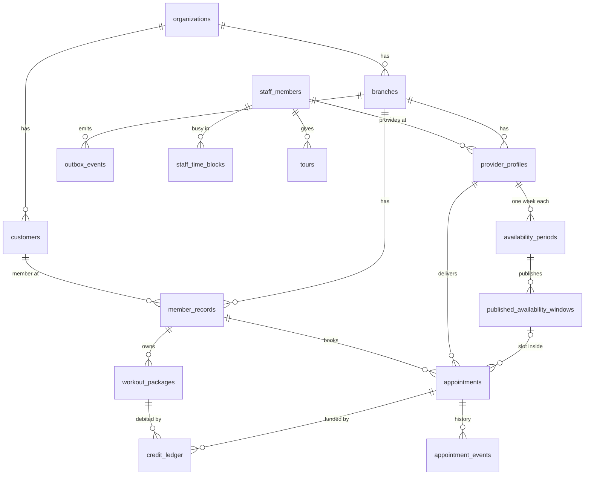

# Architecture

GymBro is a pnpm monorepo with three apps (Android, Windows, API with worker), seven TypeScript packages (five shared by the apps, two operator command-line tools for member import and branch setup) and one Postgres schema built from 123 SQL migrations. This page covers each part, the data model, sign-in and roles, how notifications travel, and how the system is deployed. The reasoning behind the main choices is in [decisions.md](decisions.md).

## Components

| Component | Stack | Role |
|---|---|---|
| Android app | Kotlin, Jetpack Compose, Material 3, OkHttp, kotlinx.serialization | Every role: members book and see their packages; staff run calendars. Strings and API models are generated from the shared packages. |
| Windows staff app | Electron 45, React 19, TanStack Query | Trainers, consultants, reception and managers. Sandboxed renderer, all network calls and tokens in the main process. |
| API | TypeScript, Hono, Zod, Drizzle ORM with hand-written SQL | 99 operations on 91 paths under `/api/v1`. Each command's work runs in one Postgres transaction. |
| Worker | Same codebase, separate process | A pass every 15 seconds through nine steps: publish weeks, book standing sessions, flag standing sessions outside hours, emit reminders, process the outbox, send push, check push receipts, clean up media, run retention sweeps. |
| Booking domain | Plain TypeScript, Temporal for time | Booking rules, availability maths, reminder timing, package funding and expiry. No framework imports. |
| API contract | Zod schemas, OpenAPI 3.1 generator | The single definition of every request and response. |
| API client, client core, strings | TypeScript | Typed fetch client, calendar layout maths shared with Android through test vectors, Hebrew and English catalogs. |
| Database | PostgreSQL 17 on Supabase, with Supabase Auth and Storage | 71 tables in one schema, row-level security on them, 12 exclusion constraints. |

## Request path

A client sends HTTPS JSON with a bearer JWT. Every write carries an idempotency header; edits carry the version the client last saw, and a stale write gets `409 VERSION_CONFLICT`.

The API checks the token, resolves the actor (account, session, acting role, branch) and checks the permission map. The idempotency layer claims the request in its own transaction with a 30-second lease, so a double tap or a network retry replays the stored answer instead of booking twice. The work then runs in a second transaction that starts with `set local role` to a restricted database role and sets the actor's ids as transaction-local settings. Row-level security policies read those settings, so the database applies the same visibility rules as the API. Nothing outlives the commit.

Postgres errors are mapped to typed error codes: an exclusion violation becomes `SLOT_UNAVAILABLE`, and a deadlock or serialization failure is retried up to twice for commands whose effects are all inside the database. The strings package maps error codes to Hebrew and English messages.

## Data model

All tables live in one `app` schema. The groups are tenancy, identity and sessions, people and roles, scheduling, booking and credits, and messaging and operations. The diagram shows the main entities with their names from the schema.

A customer belongs to the organization; a member record ties that customer to one branch. Offerings, opening hours, availability and permissions are branch-scoped. Foreign keys are composite and carry `organization_id`, and most carry `branch_id` too, so a row cannot reference another tenant's or another branch's data even through a bug in the API.

The credit ledger is append-only, guarded by a trigger that refuses updates and deletes: a booking writes a `consume` row and a cancellation writes a `return` row that reverses it, back to the package it came from. Packages keep a `used` count under a check constraint. Instants are `timestamptz`; time ranges are `tstzrange` so that exclusion constraints can compare them. Money in the schema is stored in integer minor units.

The table count is `CREATE TABLE` statements across the migrations, less the one table dropped later.

## Sign-in and sessions

Sign-in uses only a phone number and a six-digit code. The API generates the code, sends it through a WhatsApp authentication template, and stores only an HMAC-SHA256 digest bound to that challenge, compared in constant time. When the code checks out, the API mints the Supabase session itself on the server. Supabase sign-up is closed, so no client can create an account or request a code directly.

Phone sessions slide: each use renews them, and they expire after 90 days without use. A manager can revoke a staff member's sessions. People who cannot receive WhatsApp get a short reference code and are approved at the front desk after an ID check.

On Windows, the first sign-in on a PC needs a WhatsApp code and issues a device-bound remember token, stored hashed on the server and encrypted on the PC with Electron's `safeStorage`. After that, a person taps their photo and enters a four-digit PIN. The API keeps an HMAC of each PIN with a per-PIN salt and a pepper held outside the database. The app signs out after a period without input.

## Roles and tenancy

There are nine roles: member, trainer, consultant, receptionist, and five manager levels from branch manager to chain admin. A map of 38 permission grants defines what each staff role may do; the same table is in the database, and policies call a helper that reads it. Some rules are relational and live beside the map: a trainer acts only on their own trainees, a consultant only on their own meetings.

A person with several roles chooses one acting role per request, sent as a header, and sees what that role sees. Hidden appointments still block overlaps. Branches are isolated: only area managers and above can switch branch, and they work in one branch at a time.

The schema is multi-tenant (organization, then branches). The pilot builds of both clients are configured for a single branch.

## Notifications

There is no websocket or Supabase Realtime connection; the CI database even runs with realtime disabled. Changes reach people three ways:

- In-app inbox: the worker turns outbox events and due reminders into inbox rows. Clients fetch the inbox; the Windows app polls it every 60 seconds and shows a Windows notification for new entries.
- Push: the worker sends Android push through FCM HTTP v1 and records each attempt.
- Reminders: jobs for 24 hours and 2 hours before each session, created when the worker handles the booking's outbox event and replaced when the booking moves. Quiet hours from 22:00 to 07:00 local hold a reminder until the morning; if the hold reaches the session start, it is dropped.

Each worker step claims its rows with `FOR UPDATE SKIP LOCKED`, so two worker passes never process the same row.

## Windows app

The renderer runs with context isolation and the sandbox on, no Node integration and web security on. It reaches the main process only through a preload bridge and never sees tokens or build-time settings. Electron fuses turn off running as Node and the inspector, and the app loads only from an ASAR archive with integrity checking. External links pass an allowlist.

Updates come from a public GitHub repository that holds only installers and `latest.yml`. The app checks on start and installs a waiting update then; during a session it offers the update and downloads on click, with a progress bar and a 30-second stall timeout, signs out on the server before the installer runs, then restarts. The API compares an app version header with a configured minimum and answers `426` when the app is too old.

## Deployment

Only a staging environment exists. The API runs on Vercel in Frankfurt, and the database, auth and storage on Supabase. The worker is a systemd service with its own database login, outbound connections only, and a 60-second transaction timeout. Secrets live in a password manager; the repository holds only reference files that name them. Local development and CI use the Supabase CLI stack in Docker, so roles, the auth schema and every migration match the hosted database.

Windows releases are built by a release script on the operator's PC and published to the public releases repository, which holds the latest staging version. The Android app has no store release yet.
